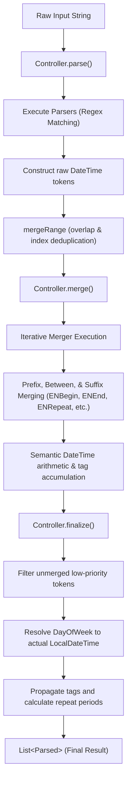

# AGENTS.md — Developer & AI Agent Guide for KWhen

Welcome to **KWhen**. This document serves as the authoritative, in-depth architectural and operational guide for autonomous agents, AI coding assistants, and human contributors working within this repository.

---

## 1. Project Overview & Mission

**KWhen** is a natural language processing (NLP) library written for **Kotlin Multiplatform (KMP)** that detects, extracts, and normalizes date, time, and recurring temporal expressions from raw textual strings into strongly typed data models (`Parsed`).

### Core Capabilities
* **Single Moment Parsing**: Specific dates, times, relative terms (e.g., `"today"`, `"yesterday"`, `"tomorrow"`, `"in the afternoon"`, `"at 4pm"`, `"midnight"`, `"3:15am"`).
* **Ranges & Intervals**: Expressions with start and end boundaries (e.g., `"from 8am to 4pm"`, `"starting Monday until Friday"`, `"for 3 days"`).
* **Recurring Expressions**: Periodic schedules and frequencies (e.g., `"every other Tuesday"`, `"daily"`, `"biweekly"`, `"every July 4th"`).
* **Relative Calculations**: Flexible relative anchors with custom base timestamps and explicit timezones (`TimeZone.of(...)`, `Clock.System.now()`).
* **Configurable Ambiguity Resolution**: Configurable hour thresholds for ambiguous timeframes (`morning`, `afternoon`, `evening`, `night`, 12-hour vs 24-hour mode).

### Platform Targets & Compatibility
Configured via Kotlin Multiplatform in [`kwhen/build.gradle.kts`](file:///Users/pahina/Documents/kwhen/kwhen/build.gradle.kts):
* **JVM**: Desktop, Server, Backend runtimes.
* **Android**: Library variants (`debug`, `release`), `minSdk = 24`, `compileSdk = 37`.
* **iOS / Apple**: `iosX64`, `iosArm64`, `iosSimulatorArm64`.
* **Linux**: `linuxX64`.
* **Windows**: `mingwX64`.

> [!IMPORTANT]
> **Strict KMP Constraint**: Never import `java.time.*`, `java.util.*`, `java.text.*`, or any platform-specific date/time APIs into `commonMain`. All temporal operations must use `kotlinx.datetime` and `kotlin.time`.

---

## 2. Architecture & Processing Pipeline

KWhen processes text through an extensible, 3-stage pipeline orchestrated by a `Controller`:



### Stage 1: Token Parsing (`Controller.parse`)
* Converts the input string to lowercase.
* Executes each configured [`Parser`](file:///Users/pahina/Documents/kwhen/kwhen/src/commonMain/kotlin/ap/panini/kwhen/common/Parser.kt) sequentially against the string.
* Parsers match regex patterns and emit raw [`DateTime`](file:///Users/pahina/Documents/kwhen/kwhen/src/commonMain/kotlin/ap/panini/kwhen/DateTime.kt) tokens containing:
  * Matched text and range (`IntRange`).
  * Relative or absolute initial `startTime` / `endTime`.
  * Category tags (`tagsTimeStart`, `tagsTimeEnd`, `tagsDayOfWeek`).
  * General numeric values and units (`generalNumber`, `generalTimeTag`) for unassociated digits or units.
  * Score points for disambiguation.
* Tokens are sorted by precedence (`points`, start index, length) and overlapping matches are filtered via `mergeRange()`.

### Stage 2: Token Merging (`Controller.merge`)
* Mergers inherit from [`Merger`](file:///Users/pahina/Documents/kwhen/kwhen/src/commonMain/kotlin/ap/panini/kwhen/common/Merger.kt) or [`MergerWhitespaceTrimmed`](file:///Users/pahina/Documents/kwhen/kwhen/src/commonMain/kotlin/ap/panini/kwhen/common/mergers/MergerWhitespaceTrimmed.kt).
* Iterates through all tokens using a sliding window looking at `left`, `right`, and text between them (`prefix`, `between`).
* Three merge strategies (`BetweenMergeOption`):
  * `NO_MERGE`: Leaves boundaries as-is.
  * `FULL_MERGE`: Merges both left and right tokens and updates the list recursively (e.g., combining a date with an adjacent time).
  * `PREFIX_MERGE`: Absorbs connector words into the left token range.
* Special semantic mergers:
  * `MergerGeneralTags`: Combines standalone quantities (e.g., `"3"`) with units (e.g., `"hours"`).
  * `ENBegin`: Processes preposition prefixes (`"starting from"`, `"at"`, `"on"`, `"next"`).
  * `ENEnd`: Handles range bounds (`"to"`, `"until"`, `"ends"`, `"for"`).
  * `ENRepeat`: Resolves recurrence indicators (`"every"`, `"every other"`).
  * `MergerConsecutive`: Unifies consecutive non-conflicting temporal markers (e.g., `"tomorrow"` + `"at 5pm"`).
  * `ENList`: Handles conjunctions in lists (`"and"`, `","`, `"&"`).

### Stage 3: Finalization (`Controller.finalize`)
* Drops orphaned numeric tokens that have no time units, tags, or recurrence markers (`points == 0` or empty tags).
* Maps relative days of the week (`tagsDayOfWeek`) forward to the nearest corresponding date from reference time.
* Normalizes recurring interval calculations (`TimeUnit.unPartial(...)`).
* Assembles the immutable public [`Parsed`](file:///Users/pahina/Documents/kwhen/kwhen/src/commonMain/kotlin/ap/panini/kwhen/Parsed.kt) models and sorts them by text position.

---

## 3. Core Data Structures & Models

### Public API

| Class | Location | Description |
|---|---|---|
| [`TimeParser`](file:///Users/pahina/Documents/kwhen/kwhen/src/commonMain/kotlin/ap/panini/kwhen/TimeParser.kt) | `ap.panini.kwhen` | Main library entry point. Accepts a `Config` and provides `.parse(input: String): List<Parsed>`. |
| [`Parsed`](file:///Users/pahina/Documents/kwhen/kwhen/src/commonMain/kotlin/ap/panini/kwhen/Parsed.kt) | `ap.panini.kwhen` | Final output item representing an extracted temporal phrase. Contains `text`, `range`, `startTime: List<LocalDateTime>`, `endTime: LocalDateTime?`, `tagsTimeStart`, `tagsTimeEnd`, `repeatTag`, `repeatOften`. |
| [`Config`](file:///Users/pahina/Documents/kwhen/kwhen/src/commonMain/kotlin/ap/panini/kwhen/configs/Config.kt) | `ap.panini.kwhen.configs` | Base abstract configuration providing reference epoch (`relativeTo`), timezone (`timeZone`), and factory method for `Controller`. |
| [`ENConfig`](file:///Users/pahina/Documents/kwhen/kwhen/src/commonMain/kotlin/ap/panini/kwhen/configs/ENConfig.kt) | `ap.panini.kwhen.configs` | English configuration class with customizable defaults: `morning = 9`, `afternoon = 15`, `evening = 18`, `night = 20`, `use24 = false`. |
| [`TimeUnit`](file:///Users/pahina/Documents/kwhen/kwhen/src/commonMain/kotlin/ap/panini/kwhen/Tag.kt) | `ap.panini.kwhen` | Enum: `SECOND`, `MINUTE`, `HOUR`, `DAY`, `WEEK`, `MONTH`, `YEAR`. Implements fractional conversion (`partial`, `unPartial`). |
| [`DayOfWeek`](file:///Users/pahina/Documents/kwhen/kwhen/src/commonMain/kotlin/ap/panini/kwhen/Tag.kt) | `ap.panini.kwhen` | Enum: `MONDAY` through `SUNDAY`. |

### Internal Components

| Class | Location | Role |
|---|---|---|
| [`DateTime`](file:///Users/pahina/Documents/kwhen/kwhen/src/commonMain/kotlin/ap/panini/kwhen/DateTime.kt) | `ap.panini.kwhen` | Internal mutable representation with scoring, tag sets, and `.merge()` logic. Implements `Comparable<DateTime>`. |
| [`Controller`](file:///Users/pahina/Documents/kwhen/kwhen/src/commonMain/kotlin/ap/panini/kwhen/common/Controller.kt) | `ap.panini.kwhen.common` | Abstract pipeline driver holding `parsers` and `mergers`. |
| [`ENController`](file:///Users/pahina/Documents/kwhen/kwhen/src/commonMain/kotlin/ap/panini/kwhen/en/ENController.kt) | `ap.panini.kwhen.en` | English controller registering all English parsers and mergers in prioritized order. |
| [`ParserByWord`](file:///Users/pahina/Documents/kwhen/kwhen/src/commonMain/kotlin/ap/panini/kwhen/common/parsers/ParserByWord.kt) | `ap.panini.kwhen.common.parsers` | Base parser adding regex word boundaries `\b(?:...)\b`. |
| [`ParserGenericNumbers`](file:///Users/pahina/Documents/kwhen/kwhen/src/commonMain/kotlin/ap/panini/kwhen/common/parsers/ParserGenericNumbers.kt) | `ap.panini.kwhen.common.parsers` | Matches raw digits (`\d+`) with 0 points. |
| [`MergerWhitespaceTrimmed`](file:///Users/pahina/Documents/kwhen/kwhen/src/commonMain/kotlin/ap/panini/kwhen/common/mergers/MergerWhitespaceTrimmed.kt) | `ap.panini.kwhen.common.mergers` | Base merger wrapping prefix and between regexes with boundary and whitespace tolerance. |
| [`Util.kt`](file:///Users/pahina/Documents/kwhen/kwhen/src/commonMain/kotlin/ap/panini/kwhen/util/Util.kt) | `ap.panini.kwhen.util` | Time manipulation utilities (`LocalDateTime.copy`, `mergeTime`, `getDateTimeWithGeneral`, `getRepeatTime`). |

---

## 4. Codebase Directory Structure

```text
kwhen/
├── .github/
│   └── workflows/
│       ├── gradle.yml             # CI build & multiplatform test verification matrix
│       └── deploy.yml             # Release deployment workflow to Maven Central
├── gradle/
│   ├── libs.versions.toml         # Version catalog (Kotlin 2.2.20, AGP 8.12.3, datetime 0.7.1)
│   └── wrapper/                   # Gradle 9.5.1 wrapper binaries
├── kwhen/                         # Core library module
│   ├── build.gradle.kts           # Multiplatform targets, dependencies, dokka, publishing
│   └── src/
│       ├── commonMain/kotlin/ap/panini/kwhen/
│       │   ├── TimeParser.kt      # Main public API
│       │   ├── Parsed.kt          # Public result data model
│       │   ├── Tag.kt             # TimeUnit, DayOfWeek, Partials
│       │   ├── DateTime.kt        # Internal working model & merge arithmetic
│       │   ├── configs/
│       │   │   ├── Config.kt      # Base configuration abstraction
│       │   │   └── ENConfig.kt    # English language config
│       │   ├── common/            # Locale-agnostic base abstractions
│       │   │   ├── Controller.kt  # Pipeline orchestrator (parse, merge, finalize)
│       │   │   ├── Parser.kt      # Abstract parser interface
│       │   │   ├── Merger.kt      # Abstract merger interface
│       │   │   ├── parsers/       # ParserByWord, ParserGenericNumbers
│       │   │   └── mergers/       # MergerGeneralTags, MergerConsecutive, MergerList, etc.
│       │   ├── en/                # English-specific implementations
│       │   │   ├── Constants.kt   # English dictionaries (months, weekdays, amounts, ordinals)
│       │   │   ├── ENController.kt# English pipeline wiring
│       │   │   ├── parsers/       # ENBasicDate, ENBasicTime, ENDayOfWeek, ENMonthDayYear, ...
│       │   │   └── mergers/       # ENBegin, ENEnd, ENRepeat, ENList
│       │   └── util/
│       │       └── Util.kt        # LocalDateTime copy/merge/general math utilities
│       └── commonTest/kotlin/
│           ├── ENTests.kt         # Comprehensive regression suite (1600+ lines of test cases)
│           ├── TimeParserTest.kt  # Test harness utilities for parse and parseAndMerge
│           └── RelativeTimesAndTimeZoneTest.kt # Fixed reference time & timezone tests
├── build.gradle.kts               # Root Gradle project configuration
├── settings.gradle.kts            # Project include & repo settings
└── gradle.properties              # Memory, caching, Dokka, and Android properties
```

---

## 5. Development & Verification Workflows

### Essential Gradle Commands

| Task | Command | Purpose | When to Use |
|---|---|---|---|
| **JVM Tests (Fast)** | `./gradlew jvmTest` | Compiles and executes tests on JVM in ~1 second. | **Primary inner loop**: Run after every code modification. |
| **All Platform Tests** | `./gradlew allTests` | Runs tests across all configured desktop/simulator targets. | Before opening a PR or finalizing larger changes. |
| **Android Unit Tests** | `./gradlew testDebugUnitTest` | Runs Android unit tests. | Verifying Android-specific target behaviors. |
| **Linux Tests** | `./gradlew linuxX64Test` | Runs Native tests on Linux. | CI environment verification. |
| **iOS Tests** | `./gradlew iosSimulatorArm64Test` | Runs Native tests on macOS for iOS Simulator. | macOS environment verification. |
| **Full Build & Check** | `./gradlew check` | Runs all verification tasks and linting. | Comprehensive pre-flight check. |
| **Generate Docs** | `./gradlew dokkaGenerate` | Builds HTML API documentation via Dokka. | Verifying KDoc documentation changes. |

### Configuration Cache & Build Speed Tips
* The project has `org.gradle.configuration-cache=true` and `org.gradle.caching=true` enabled in `gradle.properties`.
* Tests run exceptionally fast on JVM. When testing regex tweaks or new parser rules, always lean on `./gradlew jvmTest`.

---

## 6. How to Extend KWhen

### Adding a New Parser (e.g. for English)
1. **Choose Base Class**:
   * For word-bounded tokens, extend [`ParserByWord(config)`](file:///Users/pahina/Documents/kwhen/kwhen/src/commonMain/kotlin/ap/panini/kwhen/common/parsers/ParserByWord.kt).
   * For numeric tokens, extend [`ParserGenericNumbers(config)`](file:///Users/pahina/Documents/kwhen/kwhen/src/commonMain/kotlin/ap/panini/kwhen/common/parsers/ParserGenericNumbers.kt).
   * Otherwise extend [`Parser(config)`](file:///Users/pahina/Documents/kwhen/kwhen/src/commonMain/kotlin/ap/panini/kwhen/common/Parser.kt).
2. **Define `matchPattern`**: Provide the Regex pattern. Use non-capturing groups `(?:...)` when grouping without capture.
3. **Implement `onMatch(match: MatchResult): DateTime?`**:
   * Obtain a base token with `config.getDateTime(...)`.
   * Set appropriate tags (`tagsTimeStart = setOf(TimeUnit.HOUR)` etc.).
   * Set points (default is 1; use 0 for words that must be merged to be meaningful, like `"a"` or bare digits).
   * Return `null` if the match is semantically invalid (e.g., hour >= 24, day > 31).
4. **Register in Controller**: Add your parser to `ENController.parsers` in [`kwhen/src/commonMain/kotlin/ap/panini/kwhen/en/ENController.kt`](file:///Users/pahina/Documents/kwhen/kwhen/src/commonMain/kotlin/ap/panini/kwhen/en/ENController.kt).
   > [!NOTE]
   > Parser ordering matters: more specific patterns (e.g., `ENMonthDayYear`, `ENDayMonthYear`) should generally precede more generic parsers (`ENGeneralAmount`, `ParserGenericNumbers`).

### Adding a New Merger
1. **Extend [`MergerWhitespaceTrimmed(config)`](file:///Users/pahina/Documents/kwhen/kwhen/src/commonMain/kotlin/ap/panini/kwhen/common/mergers/MergerWhitespaceTrimmed.kt)**.
2. Specify `prefixMatchPattern` and/or `betweenMatchPattern`.
3. Set `mergePrefixWithLeft` and `mergeRightWithLeft` (`FULL_MERGE`, `PREFIX_MERGE`, or `NO_MERGE`).
4. Implement `onMatch(left: DateTime?, right: DateTime?, prefix: MatchResult?, between: MatchResult?): DateTime?`.
   * Check nullability and operand validity.
   * Combine date components using `left.merge(right, config = config)` or `Util.mergeTime(...)`.
5. Register in `ENController.mergers`.

### Adding a New Language (Localization Architecture)
KWhen is explicitly structured for internationalization:
1. Create a `Config` subclass (e.g., `ESConfig.kt`, `FRConfig.kt` extending `Config`).
2. Create constants maps (months, weekdays, ordinals, amounts, units) in a language-specific package.
3. Create language-specific `Controller` (e.g., `ESController`), registering the respective parsers and mergers.
4. Pass `ESConfig()` into `TimeParser(config = ESConfig())`.

---

## 7. Critical Invariants & Rules for Agents

### 1. Zero Platform-Specific APIs
* **FORBIDDEN**: `java.time.*`, `java.util.Date`, `java.text.*`, `android.util.*`.
* **MANDATORY**: `kotlinx.datetime.*` (`LocalDateTime`, `LocalDate`, `TimeZone`, `Instant`), `kotlin.time.*` (`Duration`).

### 2. Timezone & Reference Anchors
* Never call `Clock.System.now()` directly inside parser or merger logic.
* Always access reference time via `config.now()` or `config.nowZeroed()`. This ensures tests with deterministic reference timestamps (`relativeTo`) and explicit timezones pass consistently across machines and CI runs.

### 3. AM / PM & Hour Disambiguation Logic
* KWhen uses context to determine if a bare hour (e.g., `"at 5"`) refers to morning or evening:
  * If `config.use24` is true, numbers are taken verbatim.
  * If 12-hour clock, times earlier than current hour automatically advance (e.g., at 10 AM, `"at 3"` rolls over to 3 PM; at 4 PM, `"at 3"` rolls to 3 AM the next day).
* When modifying hour resolution, preserve these rollover heuristics unless explicitly addressing an hour-wrap bug.

### 4. Visibility Modifiers
* Internal types must stay internal: `DateTime`, `Controller`, `Parser`, `Merger`, `ENController`, and all parser/merger subclasses are `internal`.
* Only `TimeParser`, `Parsed`, `TimeUnit`, `DayOfWeek`, and configuration classes (`Config`, `ENConfig`) should be public.

### 5. Non-Destructive Merging
* When merging tokens, never discard `tagsTimeStart` or `tagsTimeEnd` unintentionally. Tags tell the finalizer which temporal fields were explicitly matched by the user vs which were defaulted to reference values.

---

## 8. Testing Conventions

* **Primary Test Suite**: [`kwhen/src/commonTest/kotlin/ENTests.kt`](file:///Users/pahina/Documents/kwhen/kwhen/src/commonTest/kotlin/ENTests.kt).
* **Test Harness**: [`TimeParserTest`](file:///Users/pahina/Documents/kwhen/kwhen/src/commonTest/kotlin/TimeParserTest.kt) allows testing intermediate stages:
  * `timeParser.parse(text)`: tests the parsing stage (filters out unmerged general numbers).
  * `timeParser.parseAndMerge(text)`: tests parsing + merging.
  * `TimeParser().parse(text)`: tests the end-to-end pipeline through finalization.
* When adding a feature or fixing a bug, **always add test cases to `ENTests.kt`** verifying:
  1. Extracted substring (`parsed[0].text`).
  2. Character range (`parsed[0].range`).
  3. Date and time fields (`startTime`, `endTime`).
  4. Tags (`tagsTimeStart`, `tagsTimeEnd`).
  5. Recurrence if applicable (`repeatTag`, `repeatOften`).
* Always verify that existing tests do not regress:
  ```bash
  ./gradlew jvmTest
  ```
